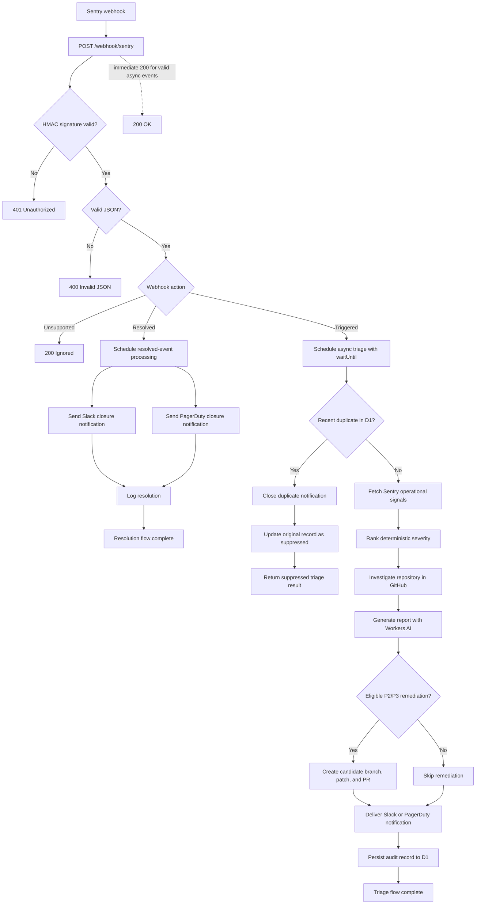
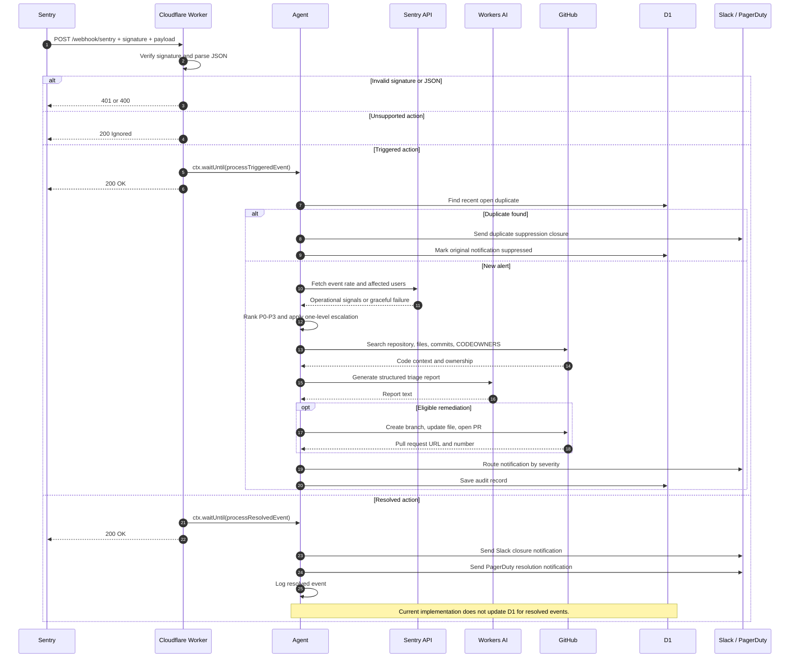
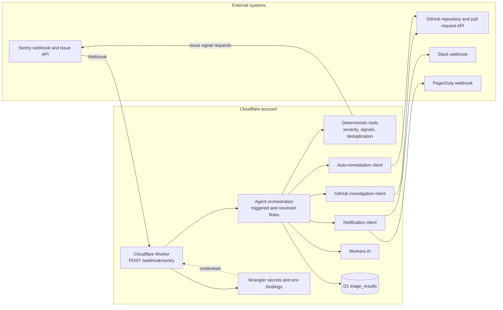
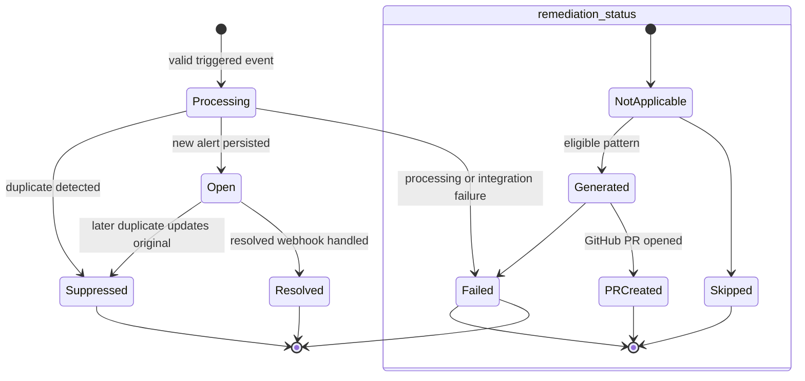

# Bug Triage Agent Architecture

These diagrams describe the current v1-v4 implementation. Mermaid keeps the architecture reviewable as text alongside the code.

## Activity Diagram

This is the end-to-end decision flow for triggered, resolved, and unsupported Sentry actions.



## Sequence Diagram

The Worker acknowledges valid triggered and resolved events immediately, while `waitUntil` runs the longer workflow.



## Component and Deployment Diagram

This combines component ownership with the current Cloudflare deployment boundary. External services remain outside the Worker deployment.



## Entity-Relationship Diagram

The durable audit record is centered on `triage_results`. `duplicateOf` is a self-reference to the original triage record; remediation is represented by fields on the triage result and an optional GitHub pull request.

```mermaid
 erDiagram
    TRIAGE_RESULT {
        string id PK
        string eventId UK
        string title
        string project
        string level
        string businessSeverity
        string culprit
        string affectedFiles
        string suggestedOwner
        string rationale
        datetime createdAt
        string notificationChannel
        string notificationStatus
        string rawPayload
        integer eventRate
        integer affectedUserCount
        string escalationReason
        string duplicateOf FK
        string resolutionStatus
        datetime resolvedAt
        boolean remediationEligible
        string remediationStatus
        string remediationPattern
        string pullRequestUrl
        integer pullRequestNumber
    }

    TRIAGE_RESULT o|--o TRIAGE_RESULT : "duplicateOf"
    TRIAGE_RESULT ||--o PULL_REQUEST : "may create"

    PULL_REQUEST {
        integer number PK
        string url
        string repository
        string status
    }
```

> Schema note: the application code reads and writes v4 fields such as `eventRate`, `affectedUserCount`, `duplicateOf`, and `resolutionStatus`. The checked-in migrations should be extended before deploying those fields to a fresh or upgraded D1 database.

## Lifecycle State Diagram

This is optional for day-to-day orientation but useful because suppression, resolution, and remediation have different state meanings.



## Why These Diagrams Are Enough

- **Activity:** explains business decisions and alternate outcomes.
- **Sequence:** explains timing, asynchronous acknowledgement, and service calls.
- **Component/deployment:** explains responsibility and runtime boundaries.
- **ER:** explains the D1 audit model and duplicate relationship.
- **Lifecycle:** explains persisted status transitions that are otherwise easy to confuse.

A class diagram, use-case diagram, and separate flowchart would mostly duplicate these views. A separate deployment diagram can be added when the system introduces queues, Durable Objects, multiple Workers, or separate environments.
